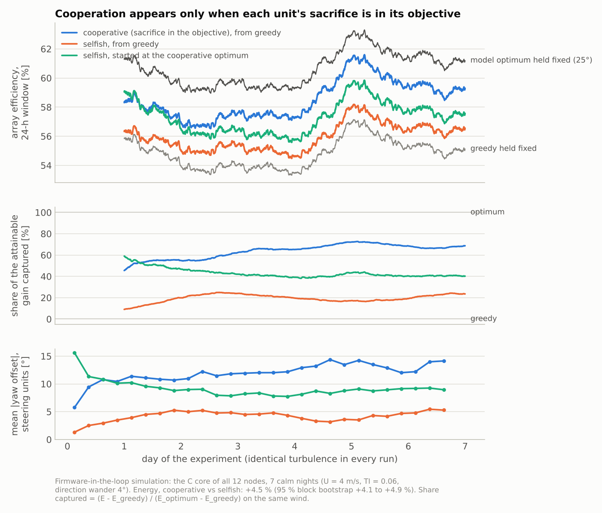
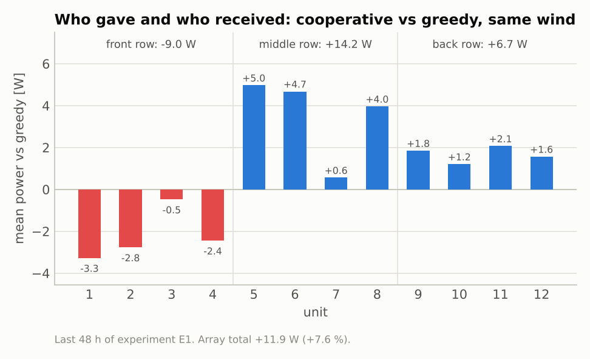
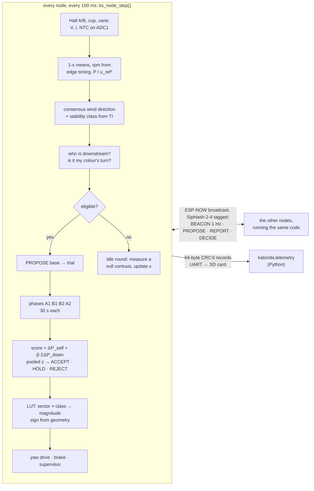
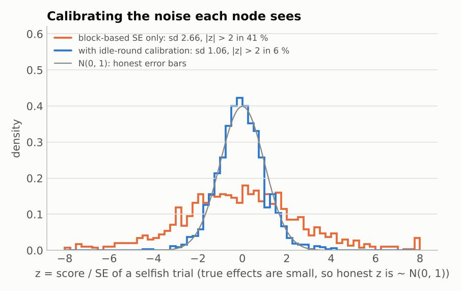
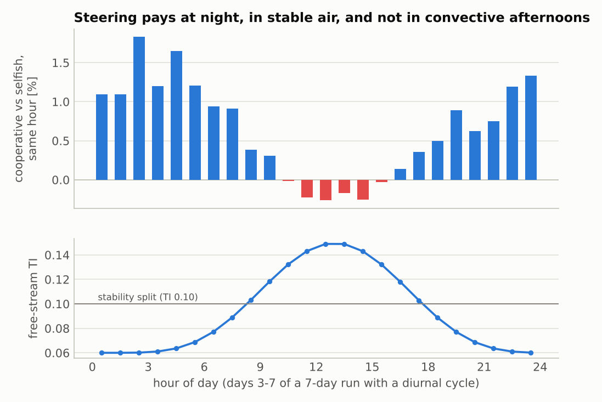
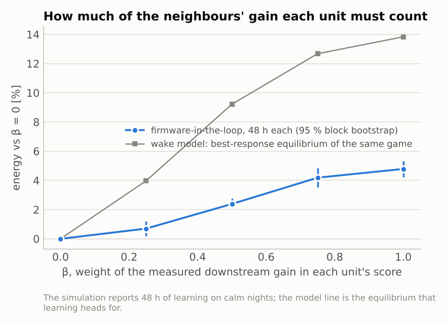
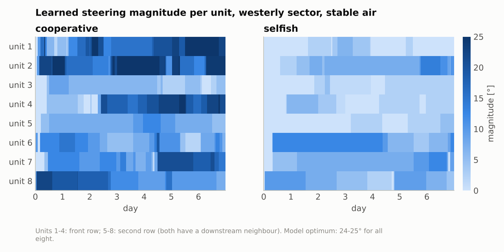
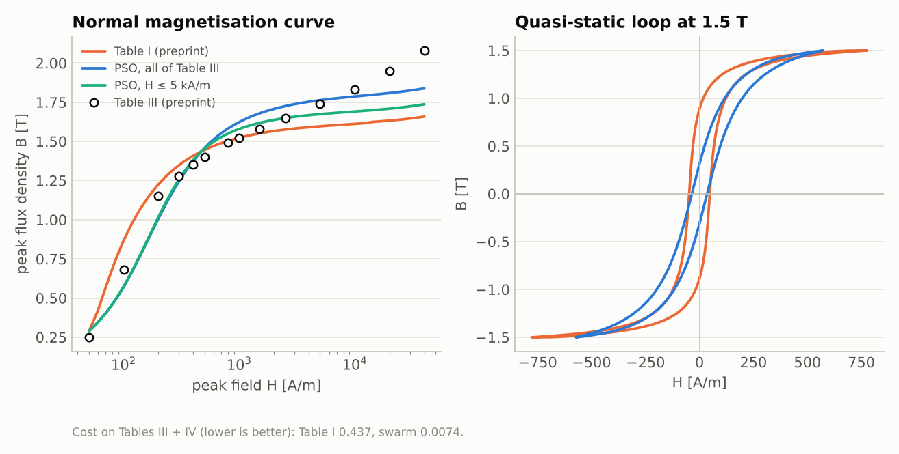

# Kalonda swarm

**Peer-to-peer wake steering for a micro-wind array: no central controller,
decisions measured, not modelled.**

Every turbine in the array runs the same firmware. A node reads its rotor
through two Hall switches and an ADC. It exchanges yaw proposals with its
neighbours over ESP-NOW and settles on its steering angle through negotiation
with the units downstream of it. No controller sits in that loop. Each trial
lasts two minutes, and trials run around the clock across the whole array,
several at a time, scheduled by the units themselves. No person could keep
up with that, so none is in the loop.

**Status: simulation only, so far.** The network ran on my Kalonda array
between January and March 2026, but its field code and logs were in
repositories I lost with an old GitHub account. This simulation repository
survived. I moved it to this account in October 2026, so its commit history
starts then. It has not yet run in the field. Every result below comes from
firmware-in-the-loop simulation: the compiled firmware of 12 nodes, stepped
against a modelled wind field and wake.
[`docs/field_protocol.md`](docs/field_protocol.md) is the plan for the field
test.

This repository holds the firmware (C99, ESP32), the firmware-in-the-loop
simulator that runs *the same compiled C* against a turbulent wind field, the
logging and analysis stack (Python), and the generator-physics companion to the
preprint behind the hardware:

* GENERIC non-equilibrium modelling;
* scalar and vector Jiles–Atherton hysteresis;
* particle-swarm identification;
* uncertainty budgets.

| at a glance | |
|---|---|
| node firmware | C99, 4 100 lines of portable core + 1 300 of ESP32/SIL ports; no `malloc`, static tables, 10 Hz loop |
| tests | 11 C test programs (5 500 checks, also under ASan/UBSan) · 76 Python tests, including byte-for-byte C↔Python checks |
| analysis | Python, 4 400 lines (`python/kalonda`) + 1 200 lines of scripts |
| radio | ESP-NOW broadcast, SipHash-2-4 tagged, replay-protected; no access point, no internet |
| evidence | firmware-in-the-loop simulation (1 600 simulated hours) |

| site and design | |
|---|---|
| site | Kalonda, Uttar Pradesh |
| controller hardware | ESP32-WROOM-32E reference design ([`docs/hardware.md`](docs/hardware.md)) |
| layout | the simulations use [`config/layouts/demo_grid_3x4.toml`](config/layouts/demo_grid_3x4.toml), a 3 × 4 reference grid |

## Highlights

### 1. A distributed system built for dust and heat

* **No master, no leader, no master clock.**
  * Epochs are synchronised by bounded max-consensus.
  * The wind direction is agreed by a consensus + innovations filter in
    which one jammed vane is out-voted.
  * Who-may-experiment-when comes from greedy colouring of the wake
    conflict graph, computed identically on every node from broadcast
    positions.
* **Built to run in dust and heat** ([`docs/hardware.md`](docs/hardware.md)):
  * no optics: the rotor's own magnets drive sealed Hall switches, and yaw is
    read by a contactless AS5600;
  * speed comes from edge *timing*, because at the 2 m/s cut-in the rotor
    turns at about 80 rpm;
  * stuck and drifting sensors are detected;
  * the supervisor derates on stator and magnet temperature. A hot rotor
    *furls* instead of shorting its bus: at the short-circuit armature field
    the N42 magnets would start to demagnetise at 65 °C.
* **Greedy is the fallback for everything.** Lost radio, missing consensus,
  any fault, an unprovisioned node: zero offset, which is always safe.
* **Authenticated broadcast.** Every frame carries a SipHash-2-4 tag under
  the array key, with replay protection by (boot, epoch, sequence).
* **Tested as it runs.** The firmware core is checked in three ways:
  * on the host: 11 programs, 5 500 checks, also under ASan/UBSan;
  * cross-checked byte for byte against the Python decoders;
  * compiled for the ESP32: 787 KB image, 35 % DRAM.

### 2. A multi-agent design problem: selfishness is an equilibrium

Steering my wake off the rotor behind me costs *me* power (cos² of the yaw)
and gives *it* power. With purely local objectives, every unit's best
response is to stop yawing. The selfish game's only equilibrium is greedy
operation, and started from the cooperative optimum it unravels back there.
Cooperation appeared only after each unit's **measured sacrifice** was
written into its own objective:

    score_i = ΔP_i (own, usually < 0) + β · Σ ΔP_j (measured on the units downstream)

With β = 1 this is the marginal-contribution ("wonderful life") utility.
When every affected unit is counted, it makes the array a potential game
whose potential is total power, so every step a unit accepts for itself is
a step up for the village. Two things made it work on noisy data, and both
are in the firmware:

* **A pooled sequential test.** Repeated A–B–B–A trials of the same yaw
  change are pooled until the evidence is decisive (z > 2 accept; z < −1, or
  12 trials, reject).
* **Honest error bars.** A node calibrates its own noise from rounds in
  which it takes no part (§6 of [`docs/multi_agent.md`](docs/multi_agent.md)).
  Without this, the per-trial standard error was about 2.5× too small. Even
  selfish units then random-walked to large yaw angles (11.5° against 3.7°),
  and that accidental "cooperation" hid half of the objective's real effect.

<picture>
  <source media="(prefers-color-scheme: dark)" srcset="figures/results_headline-dark.png">
  
</picture>

Over seven calm nights of identical simulated turbulence:

* **Cooperative vs selfish.** The cooperative array produced **4.5 % more
  energy** than the selfish one (95 % block bootstrap 4.1–4.9 %), and
  5.1 % more over the last two nights.
* **Share of what was attainable.** The same firmware, holding the model's
  optimum fixed, beats it holding greedy fixed by +10.6 % on the same wind.
  Cooperation captured 45 % of that gain on the first night and about 70 %
  from the fifth.
* **Selfish units.** They never organise. They wander only where their own
  loss is too small to measure (mean 4.4°, against the optimum's 25°),
  which by accident gives their neighbours 2.4 %.
* **Selfish from the optimum.** A selfish array started *at* the
  cooperative optimum gives it away: mean yaw falls from 25° to 9° within
  a day and to 6° after a week. Its share of the attainable gain falls
  from 100 % to about 40 %. Without the sacrifice in the objective,
  cooperation is not an equilibrium.

The ledger below answers who paid for the gain, measured against greedy on
the same wind.

<picture>
  <source media="(prefers-color-scheme: dark)" srcset="figures/ledger-dark.png">
  
</picture>

### 3. It is crude, and here is where

See [Known limitations](#known-limitations) below. In short:

* the wake cone that chooses participants is a top-hat;
* learning one wind sector takes days of calm nights;
* the controller itself costs about 2 % of a low-wind day's energy;
* the numbers above come from simulation, with real firmware but a modelled
  plant.

## How it works



* A **round** is six synchronised 30-second epochs: PROPOSE, A1 B1 B2 A2,
  REPORT/DECIDE. One colour class of the conflict graph initiates per
  round, so no two trials share a participant.
* The **steering sign** is not negotiated. It follows geometry: the wake
  goes away from the side on which the nearest downstream rotor sits, with
  hysteresis. Only the **magnitude** per (10° sector × stability class) is
  learned.
* **Who counts** (participants) comes from a crude wake cone. **What
  counts** (the benefit) is always measured.

Details: [`docs/architecture.md`](docs/architecture.md) ·
[`docs/protocol.md`](docs/protocol.md) (byte-exact) ·
[`docs/multi_agent.md`](docs/multi_agent.md).

## Results (firmware-in-the-loop simulation)

`scripts/run_sil_campaign.py` steps the compiled firmware of 12 nodes at
10 Hz. The plant around it has:

* coherent Kaimal turbulence and Ornstein–Uhlenbeck direction wander;
* a yawed Gaussian wake (Bastankhah & Porté-Agel, FLORIS form);
* rate-limited worm-gear yaw drives;
* biased vanes, noisy side-arm anemometers, and a lossy ESP-NOW channel.

Every run in an experiment sees *identical* turbulence, so differences come
from the objective alone. The reference grid is 3 × 4 units, 5 D apart
streamwise and 3 D spanwise, with D = 2 m.

| experiment | wind | comparison (paired, same turbulence) | energy gain (95 % CI) |
|---|---|---|---|
| E1 | 7 calm nights | cooperative vs selfish, whole run | **+4.5 %** (+4.1 to +4.9) |
| E1 |  | cooperative vs selfish, last 48 h | +5.1 % (+4.8 to +5.5) |
| E1 |  | cooperative vs greedy held fixed, last 48 h | +7.6 % (+7.3 to +7.8) |
| E1 |  | model optimum held fixed vs greedy held fixed (the attainable gain) | +10.6 % (+10.2 to +10.9) |
| E1 |  | share of the attainable gain captured, last 48 h | **69 %** |
| E1 |  | selfish vs greedy held fixed, last 48 h | +2.4 % (+2.0 to +2.7) |
| E1 |  | selfish started at the optimum vs selfish from greedy, day 1 → last 48 h | +4.8 % (+3.4 to +6.3) → +2.0 % (+1.7 to +2.4) |
| E2 | 48 h each | β = 0.25 vs β = 0 | +0.7 % (+0.2 to +1.2) |
| E2 |  | β = 0.50 vs β = 0 | +2.4 % (+2.1 to +2.8) |
| E2 |  | β = 0.75 vs β = 0 | +4.2 % (+3.5 to +4.8) |
| E2 |  | β = 1.00 vs β = 0 | +4.8 % (+4.2 to +5.3) |
| E3 | 7 days with a diurnal cycle | cooperative vs selfish, whole run | +0.2 % (+0.1 to +0.4) |
| E3 |  | … nights, 21–06 h, days 3–7 | +1.1 % (+0.7 to +1.5) |
| E3 |  | … afternoons, 10–17 h, days 3–7 | −0.1 % (−0.3 to +0.1) |
| E4 | 48 h | cooperative at 30 % bursty radio loss vs 5 % loss (aborts 46 % vs 11 %) | −0.4 % (−0.7 to −0.1) |
| E5 | 48 h | naive statistics: selfish units' mean learned yaw, naive → calibrated | 11.5° → 3.7° |
| E5 |  | naive statistics: z spread of selfish trials, naive → calibrated (1 = honest) | 2.66 → 1.06 |
| E5 |  | cooperative vs selfish, naive statistics / calibrated | +2.4 % (+2.0 to +2.7) / **+4.8 %** (+4.2 to +5.4) |

Regenerate with `python scripts/summarise_campaign.py`, which writes
`data/simulated/campaign_summary.json`. The 95 % intervals come from a
block bootstrap over 6-hour blocks.

**Reading the table.**

* **Cooperation needs the sacrifice in the objective (E1, E2).** The gain
  grows steadily with β, the weight each unit gives to the measured
  downstream gain.
* **Selfishness unravels cooperation (E1).** Started at the optimum, the
  selfish array gives most of it away within a day.
* **Steering is a calm-night technique (E3).** With a diurnal cycle, the
  gain lives in the stable hours (+1.1 % at night), and the convective
  afternoons give nothing. The stable bins also learn more slowly, because
  they see only the night hours.
* **Graceful degradation (E4).** A burst-lossy radio (30 % loss) aborts
  almost half the trials but costs 0.4 % of energy.
* **Honest statistics (E5).** Without calibrated error bars, noise moves
  even selfish units to large yaw angles. That accidental "cooperation"
  hides half of the objective's real effect (+2.4 % instead of +4.8 %).
  The naive rule costs the cooperative array itself nothing over 48 h
  (+0.35 %, because it accepts faster); what it breaks is the comparison.

<picture>
  <source media="(prefers-color-scheme: dark)" srcset="figures/results_calibration-dark.png">
  
</picture>

<picture>
  <source media="(prefers-color-scheme: dark)" srcset="figures/results_diurnal-dark.png">
  
</picture>

<picture>
  <source media="(prefers-color-scheme: dark)" srcset="figures/results_beta-dark.png">
  
</picture>

<picture>
  <source media="(prefers-color-scheme: dark)" srcset="figures/results_learning-dark.png">
  
</picture>

## Known limitations

These are the places where the system is crude.

1. **The wake model that chooses participants is a top-hat cone.**
   * The cone is Jensen-style: expansion 0.10, a margin of 0.5 D, out to
     15 D (`ks_geom.c`). It decides only *whose* measured power counts.
   * A unit the real wake reaches but the cone misses goes uncounted.
     Then the firmware's utility is only approximately a potential game:
     on the reference grid, the largest unilateral mismatch is 0.44 W in
     the model.
   * A cone that is too wide adds participants whose reports are pure
     noise.
2. **Learning is slow, and that is physics, not tuning.**
   * At 4 m/s, a 10° step of a front-row unit is worth about +2 W to the
     array. One trial's calibrated standard error is 4.8 W.
   * Decisions pool up to 12 trials. With 5 conflict colours, each unit gets
     a turn every 15 minutes.
   * So one wind sector takes days of calm nights to learn: after 7 such
     nights the cooperative array had captured 69 % of the gain that
     the model's optimum, held fixed, obtains on the same wind.
   * Front-row units learn slowest. Their score sums the noisy reports of
     3–4 downstream units.
3. **The simulated plant is a model.** It has:
   * quasi-steady Gaussian wakes with a 3-s lag, and direction wander as a
     single Ornstein–Uhlenbeck process;
   * a cos² yaw loss, although the literature range p = 1.88–3 moves the
     attainable gain from 14.8 % to 8.2 %;
   * a power curve from the GENERIC dynamo model, which under-reads
     Table VII at 3–4 m/s.

   The campaign tests the firmware's logic against that model.
4. **The controller costs energy.** The radio must listen continuously, so a
   node draws about 11–13 Wh/day ([`docs/hardware.md`](docs/hardware.md)).
   That is about 2 % of Unit #14's low-wind day. Simulated energies are
   rotor-side and do not subtract it.
5. **The noise calibration assumes idle rounds look like trials.** κ is
   learned from rounds in which nothing a node controls moves. A trial adds
   the initiator's own yaw motion and the response of the moving wake. In
   the simulation, calibrated selfish trials have a z spread of 1.03 to
   1.07 across the four selfish runs, against 1 for perfectly honest
   error bars. On the toy plant of the firmware tests the spread is 1.07.
6. **Coarse bins and sector-edge aborts.** The table uses 10° sectors × 2
   stability classes. A trial aborts when the initiator's sector changes
   mid-trial (6 % of cooperative decisions in E1), when a participant's
   own offset moves (8 %), or when a participant's report is lost on the
   radio (1 %). Some trials carry two flags, and 12.7 % abort in all.
7. **A keyed node can lie.** SipHash stops outsiders, not a dishonest
   member that over-reports its gain. The ledger and the passive sniffer
   make misreporting *auditable*, not impossible.
8. **The on-node ledger is an audit trail, not an account.**
   * It books measurements of *accepted* steps. A step is accepted because
     its measurement came out high, so the ledger over-states gains: the
     winner's curse.
   * Who actually gave and who received has to be measured like with like:
     toggled on/off hours in the field, or greedy held fixed in the SIL
     (the ledger figure above).
   * In the SIL, front-row units sacrifice 9.0 W between them over the last
     two nights, while the middle and back rows gain 14.2 W and 6.7 W.

## Next: a testbed for agents on shared physical infrastructure

The array is the testbed I want to use next: agents with local objectives
controlling shared physical infrastructure, where the cooperative optimum
is **measured by anemometers rather than judged by a model**. The pieces
are in place:

* a firmware ledger of who sacrificed and who gained;
* a passive sniffer that records the whole negotiation;
* keyed whole-array toggling for validation;
* energy ratios against an anemometer reference (Fleming et al. 2019).

Open questions this repository makes concrete:

* incentive compatibility (a keyed node can over-report its gain);
* fairness of the sacrifice across households;
* learning rates under real night-time signal-to-noise.

## The generator research (preprint companion)

Rana (2026), *Thermodynamic Optimization of Electromechanical Energy
Conversion: Integrating Magnetothermodynamic Feedback, Metamaterial Flux
Concentration, and Non-Equilibrium Control Architectures*, SSRN 6297482.

| | what is here | key result |
|---|---|---|
| **GENERIC** [`docs/generic.md`](docs/generic.md) | L antisymmetric with Jacobi checked numerically; M symmetric PSD from dyads; degeneracies L∂S = 0, M∂E = 0; functional derivatives on grids; a discrete-gradient integrator; the micro-dynamo, a micromagnetic chain and a rate-independent hysteron as GENERIC systems | the dynamo's energy balance against the wind's work closes to 3e-15 (relative); entropy never decreases |
| **Hysteresis** [`docs/hysteresis.md`](docs/hysteresis.md) | scalar J–A (preprint eq. A6 and JTD-1992, δ_M fix), vector J–A (Bergqvist / Leite inverse form), energy-based model, Bertotti loss separation | Table I's parameters saturate near 1.66 T; J–A's energy balance misses by 9–16 % |
| **PSO identification** | Clerc–Kennedy constriction, ring topology, log-space α; restarts map identifiability | fits Tables III + IV at cost 0.0074 (Table I's parameter set: 0.437); M_s is pinned to 0.5 %, while a, k and α trade off along a ridge |
| **Uncertainty** [`docs/uncertainty.md`](docs/uncertainty.md) | GUM (JCGM 100) and Monte Carlo (JCGM 101); error budgets; minimum detectable effect for field toggling | u(η) = 0.31 % from Table VI (torque 96 % of it); Unit #14's day integrates to 0.58 kWh |

<picture>
  <source media="(prefers-color-scheme: dark)" srcset="figures/ja_identification-dark.png">
  
</picture>

## Documentation

| document | what it answers |
|---|---|
| [`docs/architecture.md`](docs/architecture.md) | how the firmware is layered, what runs where and when |
| [`docs/protocol.md`](docs/protocol.md) | every byte on the radio and in the logs |
| [`docs/multi_agent.md`](docs/multi_agent.md) | the game, the sacrifice-aware objective, the pooled test, the noise calibration, what aborts a trial |
| [`docs/hardware.md`](docs/hardware.md) | reference wiring, dust and heat measures, the controller's power budget |
| [`docs/field_protocol.md`](docs/field_protocol.md) | commissioning, burn-in, toggled validation, analysis against anemometers |
| [`docs/generic.md`](docs/generic.md) | the generator as a GENERIC system, and the integrator that keeps both laws |
| [`docs/hysteresis.md`](docs/hysteresis.md) | Jiles–Atherton models, loss separation, PSO identification |
| [`docs/uncertainty.md`](docs/uncertainty.md) | GUM and Monte Carlo budgets, field energy, how much data a test needs |
| [`data/PROVENANCE.md`](data/PROVENANCE.md) | where every number in `data/` comes from |
| [`CHANGELOG.md`](CHANGELOG.md) | how the negotiation statistics evolved, with the evidence |

## Repository map

```
firmware/        C99 core (no malloc, static tables), ESP32 port, SIL port, host tests
python/kalonda/  swarm (SIL, inflow, wake plant, game) · wake · telemetry · generic ·
                 hysteresis · identification · uncertainty · dynamo
scripts/         campaign, model benchmarks, J-A identification, digitiser, figures
data/            preprint/ (transcribed) · reference/ (datasheets, literature) · simulated/
config/          layouts and provisioning defaults
docs/            architecture, protocol, multi-agent design, hardware, field protocol,
                 GENERIC, hysteresis, uncertainty, references.bib
figures/         every plot, light and dark, made by scripts/make_figures.py
```

## Quick start

```sh
make firmware        # build the C core, run 11 host test programs
make test            # Python suite (76 tests) against the compiled firmware
make campaign        # the simulations behind the results (~2 h on 4 cores)
make figures         # every plot in this README

cd firmware/ports/esp32 && idf.py build flash monitor          # a node (ESP-IDF 5.5)
python -m kalonda provision config/layouts/<site>.toml --key-file array.key
python -m kalonda decode node_007.bin > node_007.csv           # field logs
python -m kalonda ledger node_*.bin                            # who gave, who gained
```

Requirements: CMake ≥ 3.16 and a C99 compiler; Python ≥ 3.11 with numpy and
scipy (matplotlib for figures); ESP-IDF 5.x for the node image.

## Citation and licence

Cite with [`CITATION.cff`](CITATION.cff) and, for the generator physics, the
preprint. Code is MIT ([`LICENSE`](LICENSE)); data, documentation and
figures are CC BY 4.0 ([`LICENSE-DATA`](LICENSE-DATA)).
